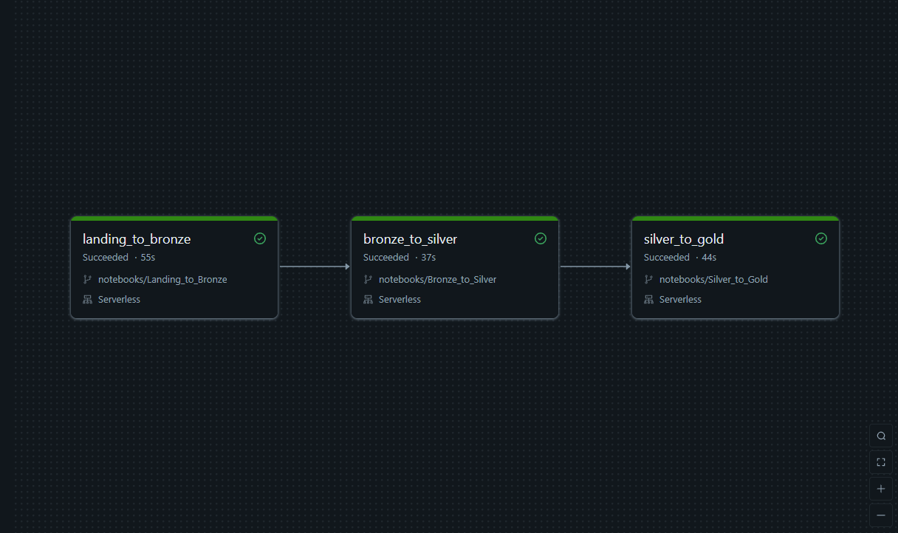
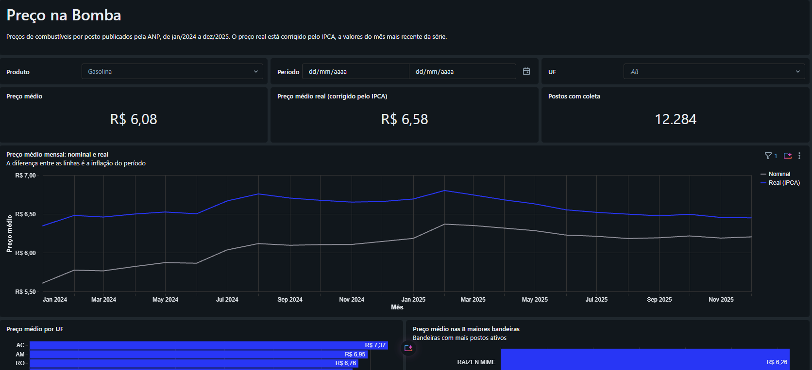

# Preço na Bomba

Pipeline de dados no Databricks com os preços de combustíveis por posto publicados pela ANP. Os dados são organizados em Arquitetura Medalhão, com carga incremental, histórico de mudanças nos postos (SCD Tipo 2) e correção dos preços pela inflação (IPCA). O resultado é um Star Schema consumido por um dashboard AI/BI.

## Arquitetura

```
Landing  Arquivos semestrais da ANP baixados para o Volume inputs + IPCA mensal via API do Banco Central
   │
   ▼
Bronze   Dado bruto em Delta, ingestão incremental com Auto Loader
   │
   ▼
Silver   Limpeza, tipagem e padronização, carga incremental com MERGE
   │
   ▼
Gold     Star Schema: dim_posto com SCD Tipo 2, dim_produto, dim_calendario e fato_precos
   │
   ▼
Dashboard AI/BI
```

Todas as tabelas ficam no catálogo `preco_na_bomba` do Unity Catalog, nos schemas `bronze`, `silver` e `gold`. O pipeline roda em compute serverless, na Databricks Free Edition.

## Estrutura do repositório

```
├── dashboard/
│   └── preco_na_bomba.lvdash.json
├── docs/
│   ├── dashboard.png
│   └── execucao_job.png
├── notebooks/
│   ├── Landing_to_Bronze.ipynb
│   ├── Bronze_to_Silver.ipynb
│   └── Silver_to_Gold.ipynb
├── pipeline/
│   └── job.yaml
└── README.md
```

| Arquivo | O que faz |
|---------|-----------|
| `notebooks/Landing_to_Bronze.ipynb` | Cria o catálogo, o schema `bronze` e o Volume `inputs`; baixa os semestres da ANP definidos no widget `semestres`; carrega os CSVs com Auto Loader e grava o IPCA da API SGS |
| `notebooks/Bronze_to_Silver.ipynb` | Limpa e tipa os preços, com carga incremental via MERGE, e calcula o índice acumulado do IPCA |
| `notebooks/Silver_to_Gold.ipynb` | Monta o Star Schema: dimensões, `dim_posto` com SCD Tipo 2, fato de preços e a view com o preço corrigido pelo IPCA |
| `pipeline/job.yaml` | Definição do Job que executa os três notebooks em sequência |
| `dashboard/preco_na_bomba.lvdash.json` | Definição do dashboard AI/BI, pronta para importar no workspace |

## Fontes de dados

| Fonte | Conteúdo | Período carregado |
|-------|----------|-------------------|
| [ANP: Série histórica de preços de combustíveis](https://www.gov.br/anp/pt-br/centrais-de-conteudo/dados-abertos/serie-historica-de-precos-de-combustiveis) | Preço de venda por posto, produto e dia de coleta, em arquivos semestrais | jan/2024 a jun/2026 (5 semestres; o último carregado de forma incremental) |
| [Banco Central: API SGS, série 433](https://dadosabertos.bcb.gov.br/dataset/433-indice-nacional-de-precos-ao-consumidor-amplo-ipca) | Variação mensal do IPCA | jan/2024 em diante |

## Camadas

### Bronze

- **Auto Loader** (`cloudFiles`) com `trigger(availableNow=True)`: o checkpoint registra quais arquivos já foram lidos, e cada execução processa só os CSVs novos da pasta `precos`
- Todas as colunas entram como texto, renomeadas para snake_case; a tipagem fica para a Silver
- `arquivo_origem` e `ingestion_datetime` registram de onde e quando cada linha veio
- Semestres que já estão no Volume não são baixados de novo

### Silver

| Tabela | Grão | Carga |
|--------|------|-------|
| `tb_precos` | Um registro por posto, produto e dia de coleta | Incremental: a Bronze é lida como stream e cada lote entra com MERGE |
| `tb_ipca` | Um registro por mês | Reescrita a cada execução, com a ingestão mais recente de cada mês |

Regras de `tb_precos`:

- CNPJ só com dígitos; CNPJs sem 14 dígitos são descartados
- Produto restrito à lista dos 6 combustíveis da pesquisa
- Unidade derivada do produto (`R$ / m³` para GNV, `R$ / litro` para os demais)
- Data convertida de `dd/MM/yyyy`; valor com vírgula decimal convertido para `decimal(10,3)` e aceito só entre R$ 1 e R$ 20
- Linhas sem CNPJ, produto, data ou valor são descartadas
- Mesmo posto, produto e dia repetidos no lote viram um registro só antes do MERGE

`tb_ipca` ganha a coluna `indice_acumulado`, o produto acumulado de (1 + variação/100) desde jan/2024, que a Gold usa para corrigir os preços.

### Gold

| Tabela | Tipo | Grão |
|--------|------|------|
| `dim_posto` | Dimensão com SCD Tipo 2 | Uma versão por posto e período de validade |
| `dim_produto` | Dimensão | Um produto |
| `dim_calendario` | Dimensão | Um dia (`sk_data` no formato `yyyyMMdd`) |
| `fato_precos` | Fato | Um preço por posto, produto e dia |
| `vw_precos` | View | Fato com as dimensões e o preço corrigido pelo IPCA |

Todas as tabelas são carregadas com MERGE, então rodar o notebook de novo não duplica registros.

## SCD Tipo 2 na dimensão de postos

Postos trocam de bandeira e de nome ao longo do tempo. A `dim_posto` guarda cada estado como uma versão, com período de validade.

- Uma versão nova começa no primeiro dia em que a bandeira ou o nome do posto muda em relação à coleta anterior; a mudança é detectada por um hash desses dois atributos
- A versão vale de `data_inicio` (inclusive) até `data_fim` (exclusive); a versão atual tem `data_fim = 9999-12-31` e `ativo = true`
- O endereço fica como estava no início de cada versão, para variações de escrita no bairro não gerarem versões falsas
- As versões são recalculadas a partir de todo o histórico da Silver, e o MERGE aplica só a diferença: fecha a versão que ganhou sucessora e insere as novas
- A fato liga cada preço à versão válida na data da coleta (`data_inicio <= data_coleta < data_fim`), então um preço de antes da troca continua associado à bandeira antiga

Resultado na carga inicial (2024 e 2025): **12.389 postos e 14.000 versões**. Houve **1.285 trocas de bandeira**, em 1.086 postos, e 336 trocas de nome. A seção [Teste de carga incremental](#teste-de-carga-incremental) mostra um posto real antes e depois de uma troca.

## Preço corrigido pela inflação

A `vw_precos` traz cada preço a valores do mês mais recente do IPCA:

```
valor_venda_real = valor_venda × indice_acumulado(mês de referência) / indice_acumulado(mês da coleta)
```

A conta fica na view, e não numa coluna da fato, porque o mês de referência muda a cada novo IPCA. Numa coluna, a fato inteira teria que ser reescrita todo mês.

## Qualidade dos dados

| Problema na origem | Tratamento | Impacto |
|--------------------|------------|---------|
| 9.114 linhas vazias no fim de `ca-2025-01.csv` | Descartadas na Silver | Nenhuma linha válida perdida |
| O mesmo CNPJ escrito em formatos diferentes entre os arquivos | CNPJ reduzido aos 14 dígitos | Na gasolina, 19.566 CNPJs distintos na Bronze correspondem a 12.284 postos reais; sem a limpeza, a contagem de postos ficaria cerca de 60% maior |
| GNV com duas unidades (`R$ / m³` e `R$ / m3`) | Unidade derivada do produto | O GNV deixa de aparecer como dois produtos |
| Valores com vírgula decimal, como texto | Conversão para decimal | Mínimo, máximo e média passam a ser numéricos, e não comparação de texto |
| 14 registros repetidos de posto, produto e dia | Unificados pelo MERGE | A fato tem exatamente um preço por posto, produto e dia |

Contagem por camada na carga inicial (2024 e 2025): 1.712.267 linhas na Bronze, 1.703.139 na Silver e 1.703.139 na fato.

## Teste de carga incremental

O semestre 2026-01 ficou fora da carga inicial para provar que o pipeline processa só o que é novo. O Job foi executado com `semestres = 2024-01,2024-02,2025-01,2025-02,2026-01`:

| Camada | Antes | Depois |
|--------|-------|--------|
| Bronze | 1.712.267 | 2.134.685 (+422.418, todas de `ca-2026-01.csv`) |
| Silver | 1.703.139 | 2.125.551 (+422.412) |
| fato_precos | 1.703.139 | 2.125.551 |
| Postos | 12.389 | 13.030 (+641 novos) |
| Versões na `dim_posto` | 14.000 | 15.002 (+1.002) |

- **Bronze:** os 4 arquivos antigos mantiveram o `ingestion_datetime` da carga inicial; o Auto Loader leu só o arquivo novo
- **Silver:** das 422.418 linhas novas, 6 foram descartadas ou unificadas pelas regras de qualidade
- **dim_posto:**
  - as 14.000 versões anteriores foram mantidas
  - das 1.002 novas, 641 são de postos que apareceram pela primeira vez e 361 de postos que já existiam (279 trocas de bandeira e 89 de nome; alguns trocaram os dois)
  - cada posto continua com uma única versão ativa

Um posto que trocou de bandeira no semestre novo:

| sk_posto | cnpj | bandeira | data_inicio | data_fim | ativo | preços na fato |
|----------|------|----------|-------------|----------|-------|----------------|
| 11 | 00027021000109 | RAIZEN | 2024-01-01 | 2026-03-09 | false | 339, de 01/01/2024 a 02/03/2026 |
| 19724 | 00027021000109 | BRANCA | 2026-03-09 | 9999-12-31 | true | 24, a partir de 09/03/2026 |

Os 339 preços anteriores à troca continuam ligados à versão Raízen.

**Idempotência:** uma segunda execução com os mesmos parâmetros terminou com exatamente as mesmas contagens em todas as camadas.

## Orquestração

O Job `preco-na-bomba`, definido em `pipeline/job.yaml`, executa os três notebooks em sequência, direto do repositório no GitHub, toda segunda-feira às 06:00 (horário de Brasília).

- Cada tarefa só começa se a anterior terminou com sucesso; se uma etapa falhar, a Gold continua com os dados da última carga válida
- A tarefa de ingestão tem 2 novas tentativas, para instabilidades no site da ANP
- O parâmetro `semestres` define quais arquivos baixar; para incluir um semestre novo, basta acrescentá-lo em **Run now with different parameters**



## Dashboard

Dashboard AI/BI construído sobre a Gold, com filtros de produto, período e UF:

- Preço médio nominal e corrigido pelo IPCA
- Evolução mensal do preço, nominal e real
- Preço médio por UF e nas 8 maiores bandeiras
- Trocas de bandeira registradas pela dimensão SCD Tipo 2



## Como executar

1. Na Databricks Free Edition, crie uma Git folder com este repositório.
2. Rode os notebooks na ordem: `Landing_to_Bronze`, `Bronze_to_Silver` e `Silver_to_Gold`. O primeiro cria o catálogo, o schema e o Volume.
3. Para agendar, crie o Job a partir de `pipeline/job.yaml`.
4. Para o dashboard, importe `dashboard/preco_na_bomba.lvdash.json` em **Dashboards > Import**.

Se o download da ANP falhar por bloqueio de rede, baixe os zips pelo navegador, extraia os CSVs, renomeie para o padrão `ca-AAAA-SS.csv` e envie para `/Volumes/preco_na_bomba/bronze/inputs/precos`. O resto do pipeline continua igual.

## Próximos passos

- Reescrever a Silver como Lakeflow Declarative Pipeline, com expectations de qualidade e tabela de quarentena para as linhas reprovadas
- Publicar o Job e o pipeline com Databricks Asset Bundles e GitHub Actions, com o repositório como fonte da verdade